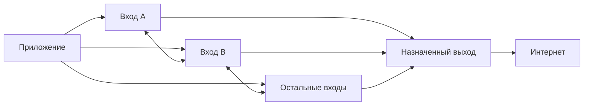

# Клиентский слой tinc для приложений Quantway

Дата: 31.10.2026. Статус: согласованы продуктовая схема и поведение; начат изолированный прототип этапа 0, [результаты и ограничения](../../audits/2026-10-31-client-tinc-stage0.md). Пользовательский режим ещё не подключён; общий механизм доставки требует проверки Android и масштаба.

Этот документ заменяет прежнюю идею mesh телефонов из `2026-10-27-android-mobile-prober.md`. Служебный меш парка описан отдельно в `2026-10-12-mesh-tinc-design.md`. План работ: `../plans/2026-10-31-client-tinc-layer.md`.

## Решения владельца

| Вопрос | Решение |
| --- | --- |
| Участники | Наши приложения на телефонах, ПК и ТВ; транзит выполняют только наши серверы |
| Входы | Приложение получает сразу весь каталог наших входов нового слоя |
| ПК и ТВ | Пока режим подключён, держат постоянные связи со всеми доступными входами; недоступные продолжают переподключаться |
| Телефоны | Получают тот же полный каталог, но динамически держат ограниченный набор активных входов |
| Выход | Пользователь выбирает страну, система назначает конкретный выходной узел |
| Область выбора | Страна и назначенный выход независимы для каждого устройства |
| Отказ выхода | Автоматическое переназначение внутри выбранной страны |
| Место в приложении | Отдельный режим рядом с существующими подключениями Quantway |
| Первый транспорт | Собственный TCP/UDP-транспорт tinc; обёртки в существующие маски не входят в первый этап |

## Пользовательская модель

В режиме tinc пользователь выбирает страну и нажимает «Подключить». Приложение само устанавливает связи со входами, а backend назначает выход в выбранной стране с учётом прав подписки, здоровья и доступной мощности. Выбор входа не привязан к выбору страны выхода.

Связи приложения с несколькими входами дают несколько путей к одному выходу. Они не означают дублирование каждого пользовательского пакета, суммирование полосы всех входов или отправку одного потока сразу через несколько выходов. В первом этапе доставка выбирает рабочий путь; алгоритм выбора проверяется прототипом.

При недоступности прямой серверной связи вход достигает выхода через другой сервер нового слоя. Телефон, ПК и ТВ не пересылают чужой трафик. Публичный IPv6 на устройстве не является условием участия: слой должен работать из IPv4-only сетей и за NAT.

«Все входы» означает все включённые серверы, развёрнутые как входы клиентского tinc-слоя. На каждом появляется отдельный tinc endpoint; существующие VLESS/HY2/AWG listeners сами по себе не становятся входами tinc. Каталог одинаково полный для выбранных стран; права подписки и выделенных пулов продолжают ограничивать допустимые выходы. Недоступность входа в текущей сети не удаляет его из каталога.

## Отдельная сеть и роли

Клиентский слой получает отдельные имя сети, ключи, адресное пространство, listeners, конфигурацию, службы и правила доступа. Конкретные префиксы и порты выбираются после проверки занятых диапазонов и сокетов. Адреса служебного меша `10.44.0.0/24`, проверочного `10.45.0.0/24` и сеть `qmesh` для клиентов не используются.

| Роль | Ответственность |
| --- | --- |
| Приложение | Собственный ключ устройства, системный VPN, связи со входами, выбранная страна и состояние соединения |
| Вход | Принимает разрешённые устройства, участвует в серверном меше, доставляет трафик к выходу |
| Сервер транзита | Обеспечивает промежуточный путь при недоступности прямой связи; физически может совмещаться со входом |
| Выход | Проверяет разрешение устройства, выпускает трафик в интернет и учитывает его |
| Backend | Каталог, регистрация ключей, права, выбор выхода, версии назначений, отзыв и доставка серверных правил |

Физическая машина может совмещать роли входа и выхода. Клиентский процесс получает доступ только к сервисам нового слоя. Админка, агенты, метрики, базы, API управления Xray и другие клиенты остаются недоступны из него. Наличие процесса tinc на том же сервере не расширяет сетевые права клиента.

## Соединения приложения

Для ПК и ТВ конфигурация содержит все входы, а приложение поддерживает исходящие метасоединения ко всем из них. Ушедший в фон интерфейс не меняет эту политику, пока работает VPN. При сне ОС соединения восстанавливаются после пробуждения. Одновременное подключение всех клиентов после сбоя сдерживается разнесёнными во времени повторами.

На телефонах начальный кандидат — один основной вход и один тёплый резерв. Это параметр прототипа, а не окончательный лимит. Приложение оценивает достижимость всего каталога с ограниченным параллелизмом, расширяет активный набор при отказе и сокращает после стабилизации. Проверки и повторы учитывают сон, тарифицируемую сеть и смену Wi-Fi/мобильной сети. Лимит активных связей одинаково действует на TCP и UDP; динамический набор меняет управляющая логика приложения, а не неконтролируемый AutoConnect tinc.

Для обеих политик нужно различать TCP-метасоединения и фактический путь данных. Перечисление входов в ConnectTo не гарантирует прохождение данных через входы: tinc может искать прямую связь с конечным участником. Конфигурация, доступность endpoints и серверные правила должны обеспечивать согласованный путь. Это проверяется захватом трафика, включая обратное направление и UDP.

Смена входа сохраняет ключ устройства, внутренний адрес и назначение выхода. Цель — восстанавливать путь без изменения внешнего IP. Сохранение уже открытых TCP/UDP-сессий проверяется отдельно; отсутствие разрывов при любых сбоях не обещается. При изменении выхода внешний IP и часть сессий могут измениться.

## Назначение выхода

Backend хранит отдельное назначение устройства: `device_id`, выбранная страна, `egress_id`, версия и срок разрешения. Назначение стабильно между обновлениями каталога и сменами входа. Пересчёт по каждому короткому измерению RTT не нужен. Правила мощности и гарантированных пулов существующей подписки сохраняются.

Backend назначает выход только после подтверждения готовности серверной конфигурации. При смене страны приложение получает новое подтверждённое назначение. Переход между версиями имеет ограниченное окно: подготовка нового разрешения, переключение, отзыв старого. Оно явно учитывается в правилах доступа, а не оставляет два выхода разрешёнными бессрочно.

При подтверждённом отказе выхода система автоматически выбирает другой здоровый узел той же страны. Изменение входа не считается отказом выхода: приложение сначала пробует другие входы и пути серверного меша. Кратковременный отказ не должен создавать постоянные переназначения.

Если вся выбранная страна недоступна, предварительная политика — состояние «Восстанавливаем соединение» без автоматического выбора другой страны. Пользователь может выбрать другую страну самостоятельно. Это допущение нужно подтвердить перед выпуском.

При недоступности backend допускается восстановление через другой вход по последнему действующему разрешению. Новый выход без подтверждённого назначения не выбирается. Обновление назначения должно быть доступно через оставшиеся входы либо независимый адрес API; единственный API-путь через умерший выход недопустим.

## Как tinc доставляет трафик к разным выходам

Назначение интернет-выхода отдельному устройству не является готовой функцией tinc. В router mode он выбирает узел по подсети адреса назначения. Общие объявления `0.0.0.0/0` или `::/0` сразу на всех выходах не выражают индивидуальные назначения backend.

Технический прототип сравнивает два варианта:

| Вариант | Смысл | Обязательное доказательство |
| --- | --- | --- |
| Адресованное соединение к выходу внутри tinc — основной кандидат | Tinc доставляет пакеты к уникальному внутреннему endpoint выхода. Авторизованный внутренний туннель/поток устройства переносит пользовательский трафик | Проверка конкретного устройства и версии назначения на выходе, работа TCP/UDP/DNS через один системный VPN, приемлемые накладные расходы |
| Прямая доставка IP-пакетов tinc — исследуемая альтернатива | Устройства видят свой назначенный default, серверы проверяют права устройства перед выпуском трафика | Привязка аутентифицированного tinc peer к source-префиксу и разрешённому выходу, устойчивые обратные маршруты; при необходимости проверяемый патч tinc |

Для основного кандидата сначала проверяется переиспользование авторизованного AWG или Xray из текущего движка с новым внутренним сетевым адаптером. Это внутренний перенос до выхода; публичный транспорт входа остаётся TCP/UDP tinc. Два слоя шифрования и их стоимость измеряются, прежде чем утверждать реализацию. Существующие route credentials нельзя автоматически считать подходящими: новые права должны быть связаны с назначенным выходом, а не с произвольным старым маршрутом.

Первый срез от 31.10 проверил на Linux VLESS с TLS до выхода, отдельные tinc edge-сегменты устройств и общий серверный core. При смене входа используется SNAT и восстанавливаются новые потоки; сохранение действующих сессий не доказано. Android отдельно проверил native packet-FD и подготовку сокетов при активном VpnService. Это результаты прототипа, а не утверждение общей схемы для массового выпуска; полный Android data path и масштаб остаются условиями выбора.

Одного фильтра по заявленному внутреннему IP недостаточно. StrictSubnets ограничивает принимаемые объявления подсетей, но в просмотренном upstream `release-1.1pre18` не доказывает привязку source IP каждого пакета к отправившему его ключу. Для production обязательно отрицательное испытание: изменённое приложение не может подменить устройство, использовать чужое назначение, другой выход или объявить свой default.

Выбор между вариантами фиксируется отдельным решением после прототипа. До этого контракт не привязывается к конкретному формату внутреннего туннеля. Собственная криптографическая схема не требуется.

## Ключи, изоляция и срок доступа

Ключ Ed25519 генерируется на устройстве и связывается с существующим `device_id`. Общего закрытого ключа аккаунта нет. Регистрация и ротация ключа используют право конкретного устройства; чтение конфигурации по ссылке подписки не предоставляет права кабинета.

Существующие проверки паузы, баланса, блокировки, отзыва и лимита устройств применяются к новому режиму. Удаление клиента или истечение права снимает не только возможность получить новый документ, но и уже выданный доступ на входах и выходах. Конкретный предельный срок отзыва и срок кешированного разрешения задаются до пилота. Отключённый от управления сервер обязан прекратить пропуск после истечения своего разрешения, иначе TTL только в клиентском JSON ничего не ограничивает.

Приложение не публикует произвольные подсети и не становится транзитом. Локальный Forwarding=off полезен для штатного клиента, но не считается защитой от модифицированного приложения. До выбора data path нужно определить доверенную точку проверки ролей и разрешённых связей либо сегментацию сети. Серверный граф не должен принимать клиентский узел в качестве промежуточного пути даже при изменённом объявлении клиента. Обычный firewall на входе не контролирует автоматически зашифрованный внутренний транзит SPTPS и прямые связи клиентов; авторизация внутреннего туннеля на выходе тоже не решает эту задачу сама по себе. Запрет пути клиент↔клиент и транзита через клиент проверяется уже в первом прототипе.

Обычный tinc распространяет сведения об участниках и связях. До массового запуска нужно проверить, какие данные о других клиентах видит устройство и как растут граф, рассылка ключей и обновления при входе/выходе устройств. Полный список серверных входов не означает выдачу каталога пользователей. Если выбранная схема раскрывает endpoints клиентов или не выдерживает целевой масштаб, она требует изменения или разделения сети до пилота.

## Контракт и встраивание в приложение

Новый документ клиентского слоя описывает версии схемы и ключей, возможности платформы, полный каталог входов, политику активных связей, внутреннюю identity устройства, выбранную страну, подтверждённое назначение выхода, срок разрешения, маршрутизацию и DNS. Серверный документ отдельно несёт разрешённые устройства и назначения. Это не копия `fleet.MeshDoc`: его служебные peers и права не выдаются приложениям.

Нужны операции регистрации ключа, получения каталога/назначения, смены страны, обновления разрешения и ограниченной диагностики. Точные API-пути выбираются при реализации. Авторизация кабинета, право устройства подключаться и отправка измерений сохраняют разные полномочия. Секреты и topology чужого провайдера не отправляются в этот API.

Слой включается для Quantway как отдельный режим. Существующие Xray/AWG-подключения и внешние подписки продолжают использовать свой путь. Приложение не переключается из tinc в другой режим без явного действия пользователя в первом этапе.

Один TunnelController владеет пользовательским системным VPN. На Android остаётся один VpnService/TUN. Внутренний tinc-интерфейс или пакетный адаптер не создаёт второе системное VPN-подключение. Все внешние сокеты tinc проходят protect и привязку к выбранной физической Network до сетевых операций; внутренняя доставка к выходу остаётся внутри overlay. После смены физической сети пересоздаются внешние сокеты, а устаревшие измерения сбрасываются.

Списки обхода VPN, личные исключения и DNS должны сохранять существующий смысл и проходить одинаковые приёмочные сценарии во всех режимах. Нельзя просто передать системный TUN процессу tinc и потерять текущую доменную политику Xray. Внешние endpoints tinc и необходимый bootstrap API имеют явный доступ через физическую сеть; пользовательский DNS не получает такой обход автоматически.

IPv4/IPv6 внешнего транспорта и IPv4/IPv6 пользовательского трафика — независимые возможности. Подключение через IPv4-only обязательно. Поддержка публичного IPv6 внутри VPN требует маршрутов и политики выхода; до её реализации сохраняется явная блокировка, исключающая утечку.

## Платформы и приоритет реализации

| Платформа | Основание в репозитории | Работа для нового режима |
| --- | --- | --- |
| Android телефон | Есть VpnService и общий движок | Native tinc, пакетный/внутренний сетевой адаптер, защита всех сокетов, динамические входы, сон и смена сети |
| Android TV | Есть Android-клиент с TV-навигацией | Тот же data path, постоянные связи со всеми входами, проверка на ТВ |
| Linux ПК | Есть прототип и отдельный сетевой помощник | Native tinc, маршруты и DNS с откатом, постоянные связи, проверка пользовательских прав |
| macOS ПК | Прототип интерфейса; системный VPN ещё не подключён | Network Extension, пакетный адаптер и упаковка; переносимость проверяется отдельно |
| Windows / iOS | Реализации в текущем дереве нет | Отдельные адаптеры, сборки и платформенные проверки |

Первый технический срез — Linux и Android телефон; затем Android TV. Это предложение по порядку доказательства схемы, а не исключение остальных платформ из продукта. Существующая серверная сборка `deploy/tinc/Dockerfile` даёт Linux/amd64, а не переносимую мобильную библиотеку. До фиксации общего интерфейса движка нужно проверить закреплённый исходник, применимость серверного патча, поддерживаемые архитектуры, возможность встраивания и распространения native-компонента с учётом его лицензии, а также реализуемость пакетного адаптера для Apple Network Extension.

## Учёт и наблюдаемость

Пользовательский трафик учитывается один раз в точке авторизованного выхода, по устройству и версии назначения. Метрики входов и транзита учитывают нагрузку инфраструктуры отдельно. Один поток через три сервера не превращается в тройной расход пользователя. Существующие Xray/AWG-счётчики сами по себе не начинают учитывать native tinc: точка счётчика зависит от выбранного data path.

В приложении достаточно страны, состояния режима и причины восстановления. В подробностях доступны активные входы, назначенный выход и свежие проверки. Диагностика различает физическую сеть, недоступность входов, разрыв серверного пути, отказ выхода, истечение разрешения и несовместимость версии. Локальная оценка доступности не подменяет доверенные наблюдения серверных маяков.

## Приёмка и открытые параметры

Приёмка должна доказать: два устройства одного аккаунта используют разные страны; два разных клиента одной сети используют разные назначенные выходы; смена входа сохраняет выход; потеря прямой серверной связи даёт путь через другой вход; отказ выхода даёт новый выход той же страны; изоляция, отзыв и учёт сохраняются при этих переходах. Испытания TCP, UDP, DNS, больших пакетов и неполного MTU выполняются на Android и Linux, а политика полного набора связей — также на TV.

До пилота фиксируются измеримые бюджеты: одновременные устройства, число входов, размер графа, память, рассылка ключей, расход телефона в фоне, время восстановления, предел задержки отзыва и накладные расходы. Эти значения пока не заданы владельцем; производственные гарантии из них не выводятся.

Открыты: окончательный механизм доставки до выхода; конкретные порты/префиксы; численные бюджеты; порядок выпуска macOS/Windows/iOS; подтверждение поведения при недоступности всей страны. Продуктовые решения из первой таблицы повторного согласования не требуют.

## Основания и исходники

- Репозиторий: `internal/topology/topology.go` (текущий Route), `internal/device/device.go`, `internal/vpn/identities.go`, `internal/vpn/select.go`, `internal/web/mobileprobe.go`, `mobile/engine/{tunnel,routing,sockets}.go`.
- [tinc 1.1: ConnectTo, Forwarding, StrictSubnets и интерфейсы](https://www.tinc-vpn.org/documentation-1.1/Main-configuration-variables.html).
- [tinc 1.1: Subnet и IndirectData](https://www.tinc-vpn.org/documentation-1.1/Host-configuration-variables.html).
- [tinc release-1.1pre18: маршрутизация пакетов](https://raw.githubusercontent.com/gsliepen/tinc/release-1.1pre18/src/route.c) и [приём SPTPS](https://raw.githubusercontent.com/gsliepen/tinc/release-1.1pre18/src/net_packet.c). Вывод о достаточности серверной проверки — архитектурная оценка этих путей кода, которую подтверждают отрицательные тесты прототипа.
- [Android: VPN и работа с сокетами](https://developer.android.com/develop/connectivity/vpn).
